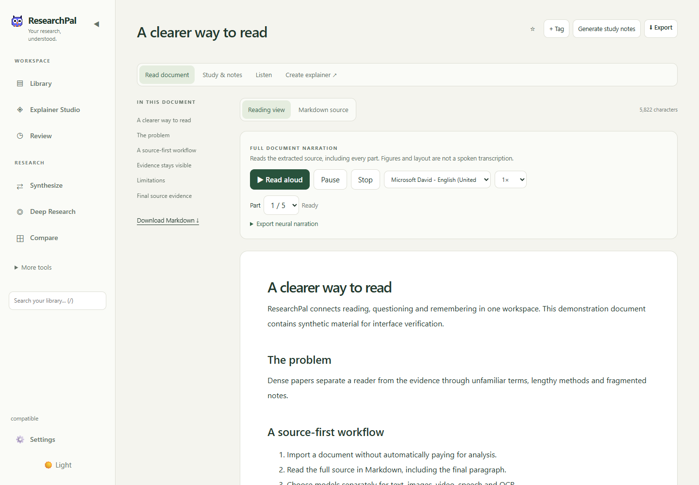
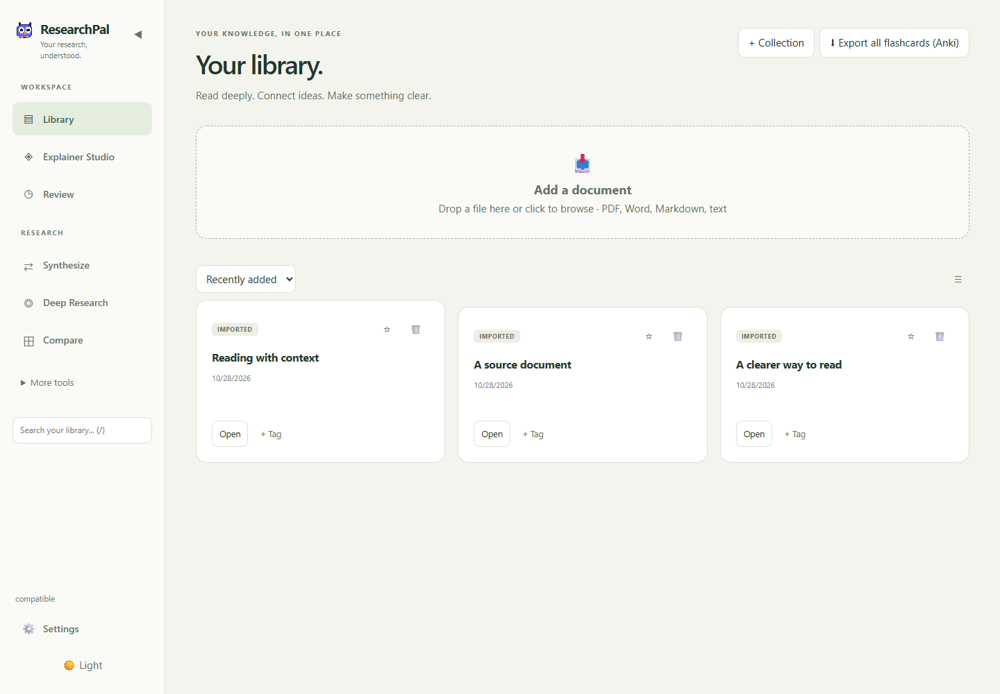
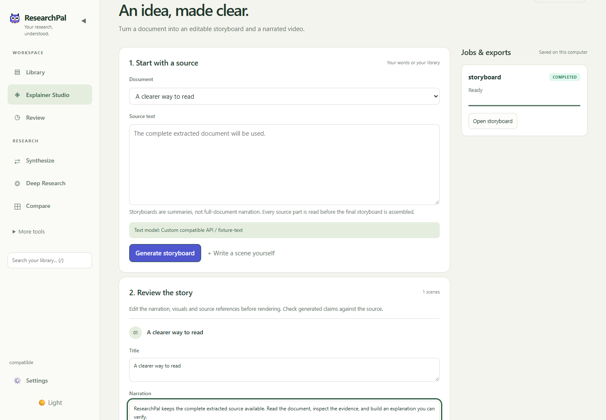
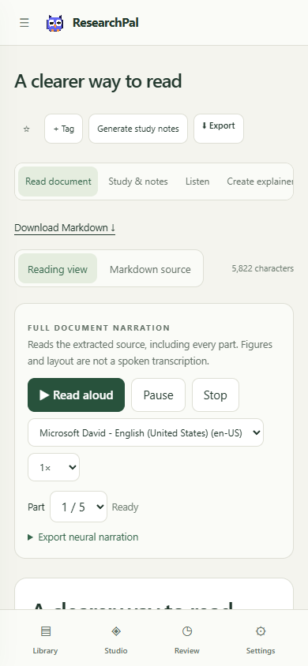
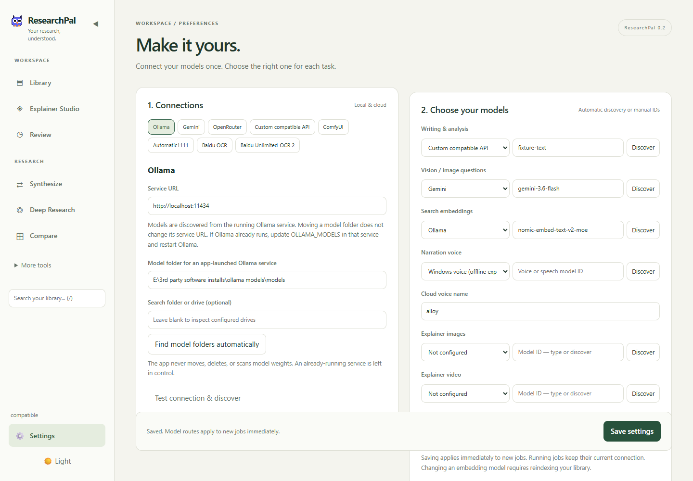
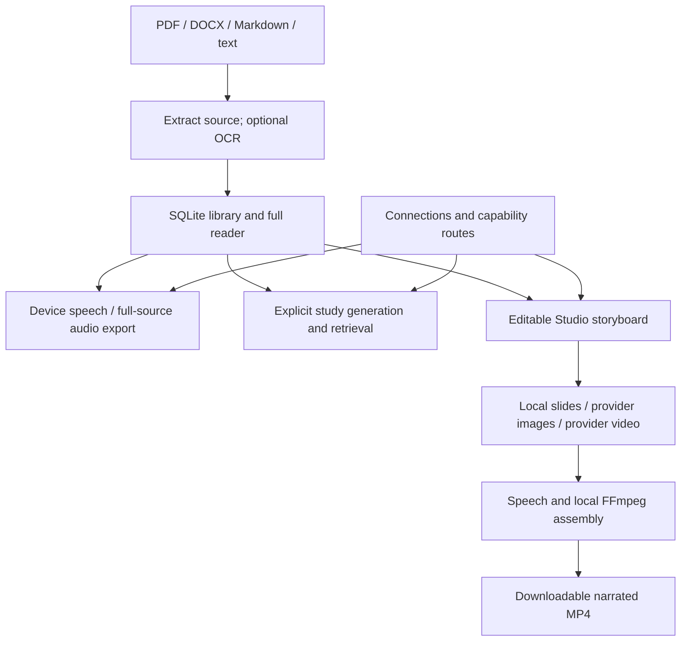

# ResearchPal

**Read the whole document. Understand the evidence. Turn what you learn into an explanation.**

ResearchPal is a local-first reading and research workspace for desktop and mobile browsers. Import PDF, DOCX, Markdown or text; read its complete extracted source; listen to narration; generate study material; and create an editable, narrated video explainer.

Version **0.2.0** adds task-specific model connections, automatic Ollama storage discovery, a full Markdown reader, source audio exports, Explainer Studio and a redesigned responsive interface. Electron wraps the same workspace as a desktop app.



*Actual interface screenshots use synthetic demonstration material. Automated screenshots use a test text service; narration and MP4 assembly use real Windows speech and FFmpeg.*

[Problem](#the-problem) · [Features](#features) · [Setup](#quick-start) · [Models](#models-and-connections) · [Architecture](#architecture) · [Verification](#verification) · [Limitations](#limitations)

## The problem

Understanding a research paper means connecting its problem, methods, assumptions, equations, evaluation conditions and limitations. Reading several papers adds the challenge of remembering which source supports which claim.

Conventional workflows scatter this work between PDF readers, notes, chat, citations and flashcards. Short summaries can drop the conditions and qualifications that give a finding meaning. ResearchPal combines these activities while retaining the complete extracted source. Reading does not require generating a summary first.

The application serves students learning technical literature, researchers organizing evidence, engineers comparing methods, and independent learners building a review routine. Generated output is an aid to investigation, not independent scientific verification.

## The end-to-end workflow

1. **Connect:** discover local/cloud models in Settings and choose a provider/model for each task.
2. **Import:** add a document. Import does not automatically start text-generation or embedding jobs; configured OCR can run during PDF extraction.
3. **Read:** explore full Markdown, follow its outline, inspect raw source or download the `.md` file.
4. **Listen:** use a device voice, or explicitly generate exported narration of every extracted source part.
5. **Study:** generate anatomy, explanations, formulas, claims, glossary terms and flashcards; check them against the source.
6. **Question:** ask about one paper, compare papers, synthesize evidence or investigate with web research.
7. **Explain:** generate or write a storyboard, edit every scene, then choose local slides, generated images or generated motion.
8. **Reuse:** download narrated MP4, complete MP3, source Markdown, notes, citations or Anki TSV, and return for spaced review.

## Features

| Area | What is available |
| --- | --- |
| Library | PDF/DOCX/Markdown/text, favorites, tags, collections and immediate source reading. |
| Markdown reader | Full extracted document, outline, tables, lists, code, math, raw source and download; sanitized HTML. |
| Full narration | Device voices with pause/resume, speed and part controls; exported MP3 parts, playlist and combined full-document MP3. |
| Paper anatomy | Title/Abstract, Introduction, Methods, Experimental Setup, Results, Related Work, Discussion, Conclusion, References, Appendix. |
| Section analysis | Long sections are visited in bounded parts rather than silently clipping tails; original headings are retained. |
| Evidence | Formulas, figures/tables/code, claim/evidence/assumption/limitation cards and generated first-principles breakdowns. |
| Learning | Mind maps, diagrams, glossary, mental models, section notes, human-written notes and FSRS flashcards. |
| Original PDF | PDF.js reading, highlights and image-region questions through the selected vision model. |
| Research | Retrieved paper questions, synthesis/critique, 2–4-paper comparison, bounded web search/fetch research. |
| Explainer Studio | Document/text → editable storyboard → narrated H.264/AAC MP4 with slides, images or motion. |
| Connections | Separate text, vision, embedding, image, video, speech and OCR routes; discovery or manual IDs/URLs. |
| Local storage | Structural Ollama folder discovery, manual override and optional desktop-managed Ollama startup. |
| Jobs | Persisted progress/results for narration, storyboards, video and reindexing; visible interruption without paid resubmission. |
| Interface | Light/dark themes, focused navigation, responsive reading and mobile bottom navigation. |
| Exports | Source Markdown, study notes, BibTeX, Anki TSV, audio and video. |

### Library and Studio





### Mobile reading



The responsive browser/PWA interface is the tested mobile path. Separate SwiftUI source under `ios-native/` remains experimental and uncompiled, without browser feature parity.

## Quick start

### Requirements

Python 3.11, Git and a modern browser are the documented development baseline. Local generation/embeddings require Ollama with models installed; cloud features need the selected provider's credentials. Node.js/npm is needed only for Electron development/packaging. Hardware requirements depend on the models; no benchmarked minimum is published.

### Windows PowerShell

```powershell
git clone https://github.com/vams2krish/ResearchPal.git
cd ResearchPal
py -3.11 -m venv .venv
.\.venv\Scripts\python.exe -m pip install -r requirements.txt
Copy-Item .env.example .env
.\.venv\Scripts\python.exe -m uvicorn server:app --host 127.0.0.1 --port 8501
```

### macOS / Linux

```bash
git clone https://github.com/vams2krish/ResearchPal.git
cd ResearchPal
python3.11 -m venv .venv
.venv/bin/python -m pip install -r requirements.txt
cp .env.example .env
.venv/bin/python -m uvicorn server:app --host 127.0.0.1 --port 8501
```

Open [the local app](http://127.0.0.1:8501) and configure Settings. [Interactive API docs](http://127.0.0.1:8501/docs) come from FastAPI. The frontend has no separate build/dev server. Reading text documents needs no model; analysis, indexing and media require their task routes.

### Desktop and installer

After Python setup:

```bash
cd desktop
npm install
npm start
```

The shell chooses an available loopback port and verifies its backend's instance identity. It does not assume a fixed-port server belongs to this app.

Build the Windows installer from the repository root:

```powershell
.\.venv\Scripts\python.exe -m pip install pyinstaller
cd desktop
npm install
npm run dist
```

Output: `desktop/dist/ResearchPal Setup 0.2.0.exe`. PyInstaller bundles Python and FFmpeg; electron-builder creates the installer. Model weights and OCR inference runtimes are not bundled. Application data stays outside the executable. Choosing a different existing library folder in desktop Settings requires restart and does not copy the old library automatically.

macOS scripts exist, but macOS packaging/native iOS compilation are not verified by this Windows workflow.

## Models and connections



Settings distinguishes a **service connection** from the **model used for a task**. A folder path is not a service URL; model storage belongs to the serving application.

| Connection | Tasks | Configuration |
| --- | --- | --- |
| Ollama | Text, vision, embeddings | Service URL, model IDs, optional storage folder for app-managed startup. |
| Gemini | Text, vision | Key and available model ID. |
| OpenRouter | Text, vision, embeddings, images, video, speech | Key, base URL, capability-appropriate model IDs; dedicated image/video discovery. |
| Compatible API | Text, vision, embeddings, images, video, speech | User URL/key; server must implement each selected protocol. |
| ComfyUI | Images, video | Service, API-format workflow, positive prompt node/input, optional checkpoint. |
| Automatic1111 | Images | WebUI with `--api`, service URL, checkpoint. |
| Unlimited-OCR 2 | OCR | Separate upstream SGLang server, `/v1` URL and served model ID. |
| Baidu cloud OCR | OCR | API/secret keys and OCR service access; separate from Unlimited-OCR. |
| Device speech | Immediate reading | Device/browser voice; no server audio export. |
| Windows speech | Offline audio/video export | Installed voice; blank model field selects its default. |
| Edge speech | Online audio/video export | Neural voice ID or default. |

Nano Banana and Seedance are model families, not universal API identifiers. Discover or enter the exact models offered by the provider/account; not every model supports every modality.

### Moving Ollama models

1. Open **Settings → Ollama → Find model folders automatically**.
2. Optionally enter a search folder/drive. Discovery checks for `manifests`/`blobs`, skips dependency/system directories and reports search limits.
3. Select a location or enter a manual path, then Save.
4. If no service runs, desktop can start Ollama with this folder. Otherwise restart the external service with updated `OLLAMA_MODELS`; ResearchPal does not take it over.
5. Discover service model IDs and assign task models.

No machine-specific model directory is committed in source. Windows discovery reads current user environment settings rather than only an inherited desktop environment. ComfyUI/Automatic1111 checkpoint folders remain server-owned.

### Cloud use and costs

Studio displays selected task providers/models before Generate. Image/video modes request one visual generation per scene; long narration needs multiple speech calls. Jobs start only on explicit actions. The UI disables silent cross-provider fallback; restart does not resubmit paid jobs automatically.

Provider pricing, quota, access and parameters are external constraints. Discovery does not prove generation access for every listed model. See [the integration guide](docs/providers.md) for endpoint contracts and upstream references.

## Reading, narration and OCR

Source narration uses extracted words, removes visual markup/file paths, visits all bounded parts and creates MP3 parts, a playlist and a combined MP3. The older PDF narration action is labelled **study summary** to distinguish it from full source narration. Spoken interpretation of mathematics, tables and layout depends on extraction and voice quality.

Automatic OCR detects image pages with little readable text. Always OCR parses the full PDF; Off accepts partial native extraction. Unlimited-OCR sends ordered page images to SGLang and checks page markers/output-budget completion. Baidu cloud OCR handles pages individually and reports quota/service errors.

There is no fixed application page-count cutoff. Memory, payload size, token budgets and inference time still bound practical workloads. Unlimited-OCR is a separate GPU service; its upstream example uses an A800 with 80 GB memory. Installing ResearchPal does not install those weights or make a small GPU sufficient. See [upstream setup](https://github.com/baidu/Unlimited-OCR).

DOCX retains text and recognized headings, not complete Word layout, embedded media or rich table structure. Convert `.doc` to `.docx` first.

## Architecture



| Layer | Implementation |
| --- | --- |
| Interface | HTML/CSS/JS modules, Marked/DOMPurify, responsive desktop/mobile views. |
| API | FastAPI/Uvicorn, source imports, connections, jobs/progress. |
| Data | SQLite, documents, connection settings, job manifests and local media. |
| Models | Ollama/Gemini/OpenRouter/compatible APIs, separate capability routes. |
| Retrieval | Configurable embeddings in SQLite BLOBs; NumPy cosine ranking. |
| Parsing | PyMuPDF4LLM/PyMuPDF, DOCX XML extraction, optional OCR servers. |
| Media | Device speech, Windows SAPI, Edge/cloud speech, Pillow, FFmpeg H.264/AAC. |
| Learning | FSRS, KaTeX, PDF.js, Mermaid, Markmap/D3; DDGS/Requests/BeautifulSoup research. |
| Distribution | Electron, PyInstaller, Windows NSIS installer. |

### Repository map

```text
ResearchPal/
├── server.py                 # API and analysis queue
├── core/
│   ├── providers.py          # Connections, discovery and task routing
│   ├── model_storage.py      # Ollama folder discovery
│   ├── documents.py          # Extraction and OCR
│   ├── jobs.py               # Persisted jobs and bounded workers
│   ├── media.py              # Narration, storyboards, image/video adapters
│   ├── pipeline.py           # Anatomy and research analysis
│   ├── vectorstore.py        # Source chunks and semantic search
│   └── ...                   # SQLite, audio, exports, review, research
├── static/                   # Shared desktop/mobile interface
├── assets/                   # Bundled renderers and icons
├── desktop/                  # Electron and installer build
├── ios-native/               # Experimental native client
├── tests/                    # Regression/API tests
├── scripts/smoke_workspace.py # Browser/API/real-media test
└── docs/                     # Guide, screenshots, verification
```

## Configuration, data and privacy

Settings saves `connections.json` in the active data directory. Keys remain server-side, are omitted from responses and never appear in media URLs. Blank inputs preserve stored keys. Local credentials are plaintext files protected by filesystem permissions, not an encrypted vault.

`.env` supplies initial/default `PRIMARY_LLM`, Gemini settings, Ollama host/text/vision/embedding settings and `OLLAMA_NUM_CTX`. Saved routes control new jobs. `OCE_DATA_DIR` overrides storage; `OCE_PORT` controls the standalone entry point. Desktop manages its available port and optional library folder.

Storage defaults: `data/` in a source checkout; `%LOCALAPPDATA%/ResearchPal` on installed Windows; `~/Library/Application Support/ResearchPal` on frozen macOS; `~/.researchpal` on other frozen systems. Back up with the app stopped before moving data. Reindex after any embedding-model change, including same-dimension changes.

Local-first does not mean offline-only. Cloud models receive source/prompts; OCR servers receive page images; web research contacts external services; Edge needs internet. Ollama uses its configured host. Windows speech and slide assembly run locally; device voice connectivity varies.

Documented/desktop backends bind to loopback and reject cross-origin browser requests. There is no multi-user login. Shared/public hosting needs separate authentication/deployment work. Mobile-browser access requires a deliberately reachable backend; the desktop shell remains loopback-only.

## Verification

```powershell
.\.venv\Scripts\python.exe -m unittest discover -s tests -v
```

The isolated Windows browser test uses Playwright and Microsoft Edge. Audio generation/playback tests are skipped by default:

```powershell
.\.venv\Scripts\python.exe -m pip install playwright
.\.venv\Scripts\python.exe scripts/smoke_workspace.py
```

It starts a temporary library/backend, imports synthetic Markdown/PDF/DOCX through the browser, checks source/table/math rendering and sanitization, exercises custom provider settings, generates an editable storyboard through an HTTP fixture, and checks a 390px mobile layout. No cloud keys or paid jobs are used. An earlier opt-in run verified Windows speech and H.264/AAC MP4 export; current tests skip audio. Use `--include-audio` only when you explicitly want those extra tests.

See [verification results](docs/verification.json). Live Ollama checks are separate from fixture-backed provider tests. Live OpenRouter/Unlimited-OCR/ComfyUI/Automatic1111 generation needs available credentials/services and is not established by an offline pass.

## Limitations

- Extraction/OCR/model output can be wrong; verify claims against the original paper.
- Section analysis covers all section parts, but some older paper-wide prompts still use clipped excerpts. Full reading/narration and Studio coverage do not imply every study tool has full context.
- Retrieval can miss evidence and is not an exhaustive audit.
- Import/OCR is synchronous; long imports can keep a request open.
- Saved jobs report interruption but do not checkpoint every remote operation. Upstream jobs may continue after local polling stops.
- ComfyUI needs compatible workflows/custom nodes and image or MP4/WebM outputs. One connection currently stores one workflow; switching image/video roles may require replacing it.
- Text-compatible APIs are not automatically image/video/speech-compatible.
- Voice languages, model access and costs vary. No extraction accuracy, processing speed or learning-outcome guarantee is published.
- Native iOS and non-Windows packaging are not validated by Windows tests.

## Troubleshooting

| Symptom | Check |
| --- | --- |
| Missing moved models | Detect/select storage, restart owning Ollama service, rediscover IDs. |
| Wrong custom host | Save connection and verify task assignments. |
| Cloud/model failure | Model ID, task capability, key, URL, quota and service availability. |
| Search fails after model change | Reindex with the chosen embedding model. |
| Scanned PDF failure | OCR server connectivity, memory, quota and output budget. |
| Audio export unavailable | Device speech is reading-only; choose Windows, Edge or cloud speech. |
| Video failure | Speech, visual provider/workflow/output nodes, saved job status. |
| No study notes | Import is source-first; explicitly Generate study notes. |
| Stale interface | Refresh browser; assets use network-first caching. Installed binaries require an update. |

## Contributions, license and acknowledgments

Use [GitHub Issues](https://github.com/vams2krish/ResearchPal/issues) for reproducible reports with workflow, OS/model versions and redacted errors. Test extraction changes with missing/nested headings, long sections and tail evidence. Never commit keys, personal documents, databases, caches or weights.

No repository-level application license has been selected. Public availability alone does not establish an open-source license. Dependencies retain their own licenses; renderer licenses are under `assets/vendor/`.

ResearchPal uses FastAPI, Uvicorn, PyMuPDF4LLM/PyMuPDF, Ollama, Google GenAI, NumPy, SQLite, FSRS, edge-tts, Electron, PyInstaller, Pillow, imageio-ffmpeg/FFmpeg, Marked, DOMPurify, KaTeX, Mermaid, Markmap/D3, PDF.js, DDGS, Requests and BeautifulSoup. Unlimited-OCR is separately deployed.
