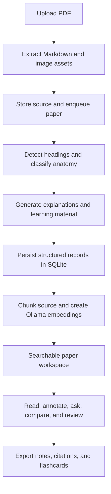

# ResearchPal

**Turn dense research papers into a structured workspace for understanding, questioning, comparing, and remembering.**

ResearchPal is a local-first research reading application built with Python, FastAPI, and a lightweight browser interface. Upload a PDF, explore its anatomy, inspect explanations alongside the original document, ask questions grounded in retrieved passages, and carry what you learn into notes, comparisons, and spaced-repetition review.

It supports local text generation through Ollama and hosted generation through Gemini, with automatic fallback between the two. Your library and application records live in SQLite and files on your machine. Hosted generation, web research, and speech synthesis can send information to external services; see [Data, privacy, and connectivity](#data-privacy-and-connectivity).


*Actual application screenshot captured from a local run. The interface is shared by the browser app and Electron desktop shell; library contents and processing status depend on your installation.*

[The problem](#the-problem) · [Features](#features) · [Quick start](#quick-start) · [How it works](#how-it-works) · [Architecture](#architecture) · [Limitations](#limitations-and-current-development)

## The problem

Reading a research paper is rarely a single task. A reader has to establish the problem, learn unfamiliar terminology, follow the method, interpret equations, connect tables and figures to claims, and judge whether the evidence supports the conclusion. Reading several papers adds another challenge: remembering which source supports each finding.

Common points of friction include:

- **Dense presentation:** technical vocabulary and mathematical notation interrupt the argument.
- **Inconsistent structure:** one paper uses Methods, another Approach, and another narrative headings that describe individual findings.
- **Lost context:** short summaries can omit experimental conditions, baselines, units, caveats, and the distinction between a result and an interpretation.
- **Fragmented tools:** PDF reading, notes, question answering, bibliography management, and revision often happen in separate places.
- **Weak retention:** finishing a paper does not guarantee that its definitions, claims, or assumptions will be remembered.
- **Difficult comparison:** similar conclusions may come from different datasets, protocols, metrics, or scope conditions.

ResearchPal brings these activities into one workspace. Its purpose is to help readers return to evidence, build understanding, and retain useful knowledge. Generated explanations and retrieved answers still require verification against the original paper.

## Who it is for

- Students learning to read technical literature and prepare for discussions or exams.
- Researchers organizing papers, comparing approaches, and identifying questions for follow-up.
- Engineers evaluating whether a published method fits a practical problem.
- Independent learners building a searchable library and a repeatable review routine.

## Features

| Area | What you can do |
| --- | --- |
| Paper library | Upload PDFs, follow processing progress, favorite papers, and organize them with tags and collections. |
| Paper anatomy | Navigate canonical sections rather than learning a different document structure for every paper. |
| Explanations | Read plain-language interpretations of section content and technical ideas. |
| Equations | View typeset formulas with explanations of their meaning and practical role. |
| Figures, tables, and code | Inspect extracted visual material, tabular data, and algorithm/code blocks. Open figures in a zoomable viewer. |
| Original PDF | Read pages rendered with PDF.js, save highlights, and use a selected image region for snip-to-ask questions. |
| Critical reading | Inspect claim cards containing evidence, assumptions, and limitations. |
| First principles | Review a generated breakdown of the paper's problem and contribution. |
| Mind maps and diagrams | Explore a section-based mind map and a generated process or architecture diagram when applicable. |
| Notes | Add section notes or write freeform notes with split editing/preview and mathematical notation. |
| Ask This Paper | Ask questions using retrieved excerpts from the selected paper; conversation history is persisted. |
| Compare | Compare 2–4 processed papers across problem, method, datasets, metrics, results, novelty, and limitations. |
| Synthesize | Ask a question across selected papers; use answer mode or a critique mode that prompts deeper evaluation. |
| Deep Research | Supplement paper excerpts with live web searches and fetched pages through a bounded research loop. |
| Mental models and concepts | Tag thinking frameworks and browse concept connections across the library. |
| Glossary | Search extracted terminology and definitions across papers. |
| Review | Practice generated flashcards using FSRS scheduling and keyboard ratings. |
| Audio | Listen to section explanations or a full-paper narration assembled from processed material. |
| Exports | Export Markdown notes, BibTeX citations, and front/back TSV flashcards for Anki. |
| Interface | Use a responsive layout, collapsible navigation, and light/dark themes. |

### A consistent map of a paper

ResearchPal groups detected source sections into the following anatomy. Only sections with available content appear in the reader.

| Section | Reading question |
| --- | --- |
| Title and Abstract | What is the paper about, and what does it claim to contribute? |
| Introduction | Why does the problem matter? |
| Methods | What approach does the paper propose or use? |
| Experimental Setup | Under which datasets, protocols, baselines, or conditions was it evaluated? |
| Results | What did the experiments or analysis find? |
| Related Work | How does this connect to earlier research? |
| Discussion | How do the authors interpret the findings? |
| Conclusion | What are the main takeaways? |
| References | Which sources does the paper cite? |
| Appendix | What supporting material accompanies the main argument? |

Classification is an organizational aid. A misplaced section or an incomplete extraction can change the apparent meaning, so use the original PDF when checking exact evidence.

## An end-to-end reading workflow

1. **Collect:** upload a PDF into Library and wait for processing to complete. Multiple uploads enter a single background queue.
2. **Orient:** read the extracted title, metadata, abstract explanation, and section navigation to understand the paper's scope.
3. **Understand:** work through the anatomy. Inspect formulas, figures, tables, and code where available, then compare the explanation with the original PDF.
4. **Challenge:** review claims, assumptions, limitations, and first-principles material. Ask which conclusions are supported and where uncertainty remains.
5. **Investigate:** ask a focused question in Ask This Paper. For questions that need newer or external information, use Deep Research and inspect its web sources.
6. **Connect:** compare several papers or synthesize a question across the library. Check whether the methods and evaluation conditions are actually comparable.
7. **Record:** save section notes, human-written notes, highlights, tags, and mental models.
8. **Remember:** review flashcards, rate your recall, and return when FSRS schedules the next review.
9. **Reuse:** export notes, citations, or flashcards for your writing and study tools.

Example questions include: “Which baseline does this result use?”, “What assumptions does the method need?”, and “Do these papers evaluate the same task under comparable conditions?”

## Quick start

### Requirements

- Python 3.11 is the documented setup target.
- Git for cloning the repository.
- Ollama with an embedding model installed; embeddings use Ollama even when Gemini handles text generation.
- A pulled Ollama text model, a configured Gemini API key, or both.
- A modern browser. Node.js and npm are needed only for the Electron desktop shell and packaging.
- RAM and storage appropriate for the models you choose. The project does not specify a benchmarked minimum hardware configuration.

### 1. Clone and install

Windows PowerShell:

```powershell
git clone https://github.com/vams2krish/ResearchPal.git
cd ResearchPal
py -3.11 -m venv .venv
.\.venv\Scripts\python.exe -m pip install -r requirements.txt
Copy-Item .env.example .env
```

macOS / Linux:

```bash
git clone https://github.com/vams2krish/ResearchPal.git
cd ResearchPal
python3.11 -m venv .venv
.venv/bin/python -m pip install -r requirements.txt
cp .env.example .env
```

### 2. Configure generation and embeddings

Edit `.env` using `.env.example` as the reference. Keep credentials out of Git.

For local generation, set `PRIMARY_LLM=ollama`, set `OLLAMA_MODEL` to a text model installed on your machine, and pull the embedding model named by `OLLAMA_EMBED_MODEL`:

```bash
ollama pull nomic-embed-text-v2-moe
ollama list
```

Pull your chosen text model with `ollama pull <your-model-name>` before using it. The application defaults are configuration values, not a guarantee that a provider currently offers a particular model. Select model identifiers available to your account or local Ollama installation.

For Gemini generation, set `PRIMARY_LLM=gemini`, supply `GEMINI_API_KEY`, and set `GEMINI_MODEL` to a model available to your account. Ollama must still be available for embedding and indexing.

Ensure the Ollama service is running. If your installation does not start it automatically, run `ollama serve` in a separate terminal.

### 3. Start the app

Windows:

```powershell
.\.venv\Scripts\python.exe -m uvicorn server:app --host 127.0.0.1 --port 8501
```

macOS / Linux:

```bash
.venv/bin/python -m uvicorn server:app --host 127.0.0.1 --port 8501
```

Open [ResearchPal locally](http://127.0.0.1:8501). The frontend is served by FastAPI and needs no separate build or development server. Interactive API documentation is available at [the local API docs](http://127.0.0.1:8501/docs).

### 4. Process your first paper

Open Library, upload a text-based research PDF, and follow its processing status. Once processing finishes, open the paper and move between the anatomy sections, original PDF, notes, and analysis tools.

Processing time depends on paper length, model speed, provider availability, and local hardware. The project does not publish a guaranteed processing time or extraction-accuracy benchmark.

## Configuration

| Variable | Purpose |
| --- | --- |
| `PRIMARY_LLM` | First generation backend to try: `gemini` or `ollama`. |
| `GEMINI_API_KEY` | Credential for hosted Gemini generation. |
| `GEMINI_MODEL` | Gemini model identifier. |
| `OLLAMA_MODEL` | Local text-generation model. |
| `OLLAMA_VISION_MODEL` | Local vision model for image questions; defaults to the text model if unset. |
| `OLLAMA_HOST` | Ollama service address; default `http://localhost:11434`. |
| `OLLAMA_EMBED_MODEL` | Local embedding model; default `nomic-embed-text-v2-moe`. |
| `OLLAMA_NUM_CTX` | Requested Ollama context window; default `8192`. Larger values increase memory use. |
| `OCE_DATA_DIR` | Override the application data directory. Set this in the process environment before launching. |
| `OCE_PORT` | Port used by `python run_backend.py`; default `8501`. With the uvicorn command, use `--port`. |

Generation automatically tries the other backend after the primary backend fails. The sidebar reports backend status. A vision-capable model is required for local image-region questions.

## How it works



1. **Extraction:** `pymupdf4llm` converts the PDF to Markdown and can write image assets. Layout quality affects downstream headings, equations, tables, and captions.
2. **Structure:** heading blocks are classified into canonical anatomy categories. Tables, images, and code are collected from those blocks.
3. **Analysis:** model calls generate explanations, formulas, metadata, claims, first-principles steps, flashcards, diagrams, and glossary entries. These are interpretations of extracted material.
4. **Persistence:** SQLite stores the library, structured analysis, notes, chats, learning records, and embeddings; files hold PDFs, images, and cached audio.
5. **Retrieval:** source chunks are embedded locally through Ollama. NumPy cosine similarity ranks stored embeddings for a question; selected excerpts become answer context.
6. **Presentation:** browser modules render the reader and learning tools. The same frontend powers the Electron desktop shell.

The mind map is built from stored section and asset data rather than requiring another model call. The process/architecture diagram is generated separately when appropriate.

### Why processing is queued

A single background worker processes papers one at a time. This limits competing model loads and memory pressure on local hardware. The queue itself is in memory; on startup, the server requeues records still marked `uploaded`. This is basic recovery, not a durable distributed job system or a checkpointed resume of every analysis step.

## Architecture

| Layer | Implementation | Responsibility |
| --- | --- | --- |
| Browser UI | HTML, CSS, JavaScript ES modules | Hash-based navigation, library, reader, notes, learning tools. |
| API | FastAPI / Uvicorn | JSON endpoints, file serving, progress streams, and processing dispatch. |
| Paper processing | Python modules under `core/` | PDF extraction, anatomy, prompts, exports, and research workflows. |
| Generation | Ollama and Google GenAI SDK | Text and vision generation with backend fallback. |
| Retrieval | Ollama embeddings, SQLite BLOBs, NumPy | Local embedding storage and similarity ranking. |
| Data | SQLite and local folders | Persistent records, PDFs, image assets, and audio cache. |
| Rendering | KaTeX, Mermaid, Markmap / D3, PDF.js | Math, diagrams, mind maps, and PDF pages. |
| Learning | FSRS | Flashcard scheduling and review history. |
| Speech | edge-tts | Network speech synthesis with local caching. |
| Web research | DDGS, Requests, BeautifulSoup | Search, page retrieval, and readable web text. |
| Desktop | Electron and PyInstaller | Native shell and bundled backend distribution. |

### Repository layout

```text
ResearchPal/
├── server.py                 # FastAPI routes, static serving, and worker queue
├── run_backend.py            # Standalone / packaged backend entry point
├── core/
│   ├── anatomy.py            # Canonical section names
│   ├── pdf_parser.py         # PDF-to-Markdown and image extraction
│   ├── pipeline.py           # Analysis, paper questions, comparison, synthesis
│   ├── llm.py                # Generation, vision, embeddings, backend fallback
│   ├── vectorstore.py        # Chunking and cosine similarity search
│   ├── db.py                 # SQLite schema and persistence
│   ├── research.py           # Paper-grounded web research loop
│   ├── scheduler.py          # Flashcard review scheduling
│   ├── audio.py              # Speech and audio caching
│   ├── export.py             # Markdown, BibTeX, and Anki TSV
│   └── config.py             # Environment and data paths
├── static/                   # Browser UI, styles, views, manifest, service worker
├── assets/                   # Bundled rendering libraries and icons
├── desktop/                  # Electron shell and packaging configuration
├── ios-native/               # Experimental SwiftUI client source
├── docs/images/              # README screenshots
├── .github/workflows/        # Build automation
├── .env.example              # Configuration template without credentials
└── requirements.txt          # Python dependencies
```

## Desktop and mobile

### Electron desktop shell

After installing the Python dependencies and configuring the backend:

```bash
cd desktop
npm install
npm start
```

To build the Windows installer, install PyInstaller in the project virtual environment and run:

```powershell
..\.venv\Scripts\python.exe -m pip install pyinstaller
npm run dist
```

The script freezes the backend and packages an Electron NSIS installer into `desktop/dist/`. The Windows installer supports per-user installation and a selectable install directory. The package also includes macOS build scripts; macOS packaging requires the corresponding platform/toolchain and has not been validated by this README update.

### Browser installation and iOS source

The web frontend includes a manifest, service worker, mobile layout, and home-screen metadata. These do not make backend analysis available offline: the API and configured models still need to be reachable, and browser installation behavior depends on platform and secure-origin requirements.

`ios-native/` contains an experimental SwiftUI client for the library, section reader, and paper questions. Its own setup guide states that it has not been compiled or run and is not a complete feature-equivalent app. See [the iOS setup notes](ios-native/SETUP.md) before using it.

## Data, privacy, and connectivity

ResearchPal is local-first, with optional external processing. It is not automatically an offline-only application.

| Activity | Data / connectivity behavior |
| --- | --- |
| Library and records | Stored in the configured local data directory. |
| Ollama text generation | Sent to the configured Ollama host, which may be local or remote. |
| Embeddings | Sent to Ollama regardless of the text-generation backend. |
| Gemini generation | Prompts and relevant paper text or image content are sent to Gemini. |
| Automatic fallback | Can switch from local generation to Gemini when configured and the local call fails. |
| Deep Research | Sends search queries and requests external pages; the resulting context is processed by the active model backend. |
| Audio narration | Uses edge-tts over the network and saves generated audio locally. |
| Secrets | Read from environment / `.env`; desktop settings can persist provider configuration. Do not commit credentials. |

Running from source normally stores data in `data/`, including `app.db` and `papers/`. Frozen builds default to `%LOCALAPPDATA%/ResearchPal` on Windows, `~/Library/Application Support/ResearchPal` on macOS, or `~/.researchpal` on other platforms. `OCE_DATA_DIR` overrides the location. Back up the data directory before moving or replacing an installation; prefer a stopped backend when copying SQLite files.

The backend currently has no application authentication and permits broad CORS access. The quick-start command binds to loopback. Use the app as a personal local tool; public or shared-network hosting needs an access-control and deployment review.

No paid search API is required by the implementation. Model access, quotas, service availability, and provider pricing depend on your configuration and are not guaranteed by the project.

## Limitations and current development

- **Extraction is imperfect.** Scanned PDFs, complex layouts, mathematical notation, captions, and multi-column reading order can produce incomplete or misplaced text. There is no documented dedicated OCR workflow.
- **Generated analysis can be wrong.** Explanations, claims, diagrams, first-principles steps, and flashcards are model output. They are not independently verified scientific conclusions.
- **Context coverage is limited in the published pipeline.** The current section-analysis path clips each section to 2,800 characters. Several paper-wide generation prompts also clip source text. Retrieval selects a subset of excerpts rather than supplying the full paper for every answer.
- **Anatomy improvements are in local development.** Changes to analyze all section parts, preserve headings, retain unstructured content, bound retrieval chunks, and expose complete section source text are pending publication separately from this documentation update. Existing stored analysis is not regenerated by changing the README.
- **Retrieval can miss evidence.** Semantic similarity is a relevance heuristic, not proof that all supporting or contradictory passages were found.
- **Model and provider availability vary.** Local generation depends on hardware and installed models. Hosted generation can fail because of credentials, quota, connectivity, or unavailable model identifiers.
- **Recovery is basic.** Startup requeues uploaded papers, but there is no durable task broker or per-step checkpoint system.
- **Anki export is TSV.** It is not a packaged `.apkg` deck; choose the destination deck and note fields during import.
- **Platform maturity differs.** The browser and Electron shell are the main application paths; the native iOS source is explicitly experimental.
- **No published evaluation benchmark.** This repository does not establish extraction accuracy, answer faithfulness, learning gains, or a fixed processing-speed guarantee.

Useful next steps include stronger source references for generated statements, better long-document coverage throughout paper-wide tools, OCR handling, retrieval evaluation, and more resilient job recovery. These are improvement directions, not claims of completed features.

## Troubleshooting

| Symptom | What to check |
| --- | --- |
| The page does not open | Confirm Uvicorn is running, use the matching host/port, and check whether another process occupies port 8501. |
| Generation fails | Check the sidebar backend indicator, provider configuration, local model availability, and server error output. |
| Search or indexing fails while summaries work | Verify Ollama is running and the configured embedding model is installed. Gemini does not replace embedding generation. |
| Snip-to-ask fails locally | Set `OLLAMA_VISION_MODEL` to an installed vision-capable model or configure supported hosted vision generation. |
| Paper content looks incomplete | Check the original PDF, extracted text, layout quality, and the context limitations above. |
| Processing is slow | Try a smaller model, inspect memory pressure, and allow the serial queue to finish. Raising context size also increases memory use. |
| Audio fails | Confirm internet connectivity; speech synthesis is network-dependent. |
| A UI update is missing | Refresh the page and check browser/service-worker caching and that the intended backend is running. |
| Another device cannot connect | Loopback addresses refer to the device itself. Network access requires an appropriate bind address and firewall configuration; review access controls before exposing the service. |

## Development and contributions

The frontend has no bundler: edit modules under `static/js/` and styles under `static/css/`, then refresh. Backend changes require a server restart unless you run Uvicorn with `--reload` for development.

Before submitting changes, check the affected workflow with a representative paper and inspect the resulting source/analysis pairing. For extraction or retrieval changes, include cases with long sections, nested headings, missing headings, and evidence near the end of a document. Never include personal papers, databases, credentials, or generated caches in a contribution.

Report reproducible problems through [GitHub Issues](https://github.com/vams2krish/ResearchPal/issues). Include the relevant workflow, operating system, Python version, model backend and model identifier, and redacted error output. Share a paper only when you have permission to distribute it.

## License and acknowledgments

A repository-level license file is not currently included. Public source availability does not by itself grant a particular open-source license; the owner should add an explicit license before making licensing claims.

ResearchPal builds on FastAPI, Uvicorn, PyMuPDF4LLM, Ollama, Google GenAI, NumPy, SQLite, FSRS, edge-tts, Electron, PyInstaller, KaTeX, Mermaid, Markmap, D3, PDF.js, DDGS, Requests, and BeautifulSoup. These projects retain their own licenses and terms.
